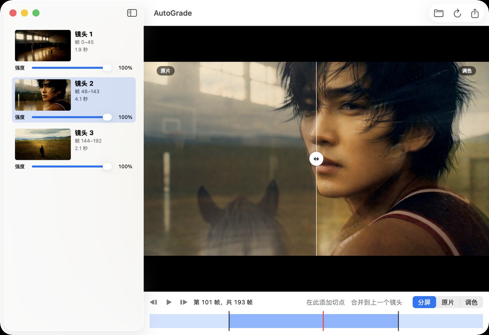

<!-- README_SYNC: source=main@8646248+working-tree; updated=2026-11-02 -->
<p align="center">简体中文 · <a href="./README_EN.md">English</a></p>

# AutoGrade

在 Mac 上按镜头自动给视频调色：AdaInt 为每个镜头生成一份 3D LUT，你可以预览、调强度、改切点，再导出视频和 `.cube`。

如果它对你有用，欢迎[点个 Star](https://github.com/Shaojie66/AutoGrade/stargazers)，方便以后找到，也让有同样需求的人更容易发现它。

[](https://github.com/Shaojie66/AutoGrade/stargazers)
[](#环境要求)
[](project.yml)
[](https://github.com/Shaojie66/AutoGrade/issues)
[](https://github.com/Shaojie66/AutoGrade/commits/main)
[](LICENSE)

> [!IMPORTANT]
> 代码按 PolyForm Noncommercial 1.0.0 源码公开，仅限非商业使用；模型权重用 MIT-Adobe FiveK 训练，`fixtures/` 含 FiveK 图片，均仅限研究、不得商用。详见[许可与素材](#许可与素材)及 [licenses/README.md](licenses/README.md)。



2026-11-02 的 App 界面截图：`gym` 素材分为 3 个镜头，第 101 帧以分屏对比原片和调色结果。

## 为什么使用 AutoGrade

- **按镜头应用 LUT**：模型逐帧预测，再在镜头内平均为一份 LUT，减少逐帧变化带来的闪烁。`comic` 试跑中帧间闪烁最大值从逐帧的 7.8 降到每镜头的 2.9 级。
- **结果可以交给其他软件**：默认每镜头导出一份 65³ `.cube`；ffmpeg `lut3d` 套用结果与 Metal 最大相差 1 LSB。
- **原生运行**：Swift、Metal、CoreML 和 AVFoundation；运行时不依赖 Python 或 ffmpeg。4K 分析实测约 15–17 ms/帧，机器有负载，仅供参考。
- **数值有对照**：AiLUT 套用与上游官方算子对照达到 8-bit 0 LSB；预览像素与导出编码前像素逐字节相同，特定画面的预览与 QuickTime 显示差 ≤0.4 级。
- **切点可修正**：加切点只重新分析被拆分的镜头；删切点通过累加和精确合并，无需重新分析。

## 快速开始

### 环境要求

需要 macOS 15 或更新版本、Apple Silicon、Xcode 和 `xcodegen`。仓库已有 `Resources/Models/AdaIntFiveK.mlpackage`；普通构建不需要 Python。研究工作流还需要 `uv`、Python 3.11、`ffmpeg`、`ffprobe` 和原始测试视频；完整测试需要 `ffmpeg`，缺少时 `.cube` 的 ffmpeg 对照测试会跳过。

在仓库根目录构建 App，并打开合成样片：

```bash
xcodegen generate
xcodebuild -project AutoGrade.xcodeproj -scheme AutoGrade \
  -derivedDataPath build/DerivedData build
open -a build/DerivedData/Build/Products/Debug/AutoGrade.app fixtures/synthetic_shots.mp4
```

打开后自动分析；在界面中预览结果，调整镜头强度或切点，然后导出。

## 使用图形界面

1. 用 `⌘O`、拖入视频或上面的 `open -a` 命令打开素材；分析过程中可以取消。
2. 左侧显示镜头缩略图、帧范围、时长和 0–100% 强度滑块。点击镜头定位；预览可选分屏、原片或调色，分屏线可以拖动。
3. 在时间线拖动定位，播放或逐帧查看。加切点后两半沿用原强度；合并到上一个镜头时沿用前一个镜头的强度。
4. 导出时选择 HEVC 或 ProRes 422，也可以同时导出每镜头 `.cube`。视频重名时在保存面板确认替换，成功写入同目录临时文件后才替换；`.cube` 重名会另行确认。
5. 设置中可选择跟随系统、English 或简体中文，切换后立即生效。

| 操作 | 快捷键 |
|---|---|
| 打开视频 | `⌘O` |
| 导出 | `⌘E` |
| 播放 / 暂停 | `Space`（空格） |
| 上一帧 / 下一帧 | `←` / `→` |
| 在播放头处加切点 | `⌘K` |
| 合并到上一个镜头 | `⌘⌫` |

## 使用命令行

构建 Release 版本，然后处理合成样片并导出每镜头 LUT：

```bash
xcodebuild -project AutoGrade.xcodeproj -scheme autograde \
  -configuration Release -derivedDataPath build/DerivedData build
mkdir -p out
build/DerivedData/Build/Products/Release/autograde fixtures/synthetic_shots.mp4 \
  -o out/synthetic_graded.mov --cube-dir out
```

```text
autograde <input> -o <output.mov> [--cube-dir DIR] [--cut 0.25] [--size 65] [--codec hevc|prores]
```

- `-o` / `--output`：输出 `.mov` 路径。
- `--cube-dir`：可选，按输入文件名前缀保存每镜头 `.cube`。
- `--cut`：颜色直方图 L1 距离切镜阈值，默认 `0.25`。
- `--size`：LUT 每轴格点数，默认 `65`，范围 `2...129`。
- `--codec`：`hevc` 或 `prores`，默认 `hevc`；`-h` / `--help` 显示帮助。

命令行不覆盖已有视频或 `.cube`，请使用新的输出路径。

## 工作原理

第一遍解码视频、转为 RGB、缩放并由 AdaInt 逐帧预测 LUT 和 vertices；颜色直方图负责切镜。预测结果烘焙到均匀格点，在每个镜头内累加、平均并截断到 `[0, 1]`。第二遍重新解码，按镜头套用最终 LUT，再编码 `.mov`；同一份 LUT 可导出为 `.cube`。

输入按 display-referred 处理；模型缩放采用双线性插值和 `align_corners=False`。强度在镜头 LUT 与恒等 LUT 之间混合。预览和导出共用分析结果、含强度的最终 LUT 与 Metal 调色算子；分屏逐像素选源，经 `AVSampleBufferDisplayLayer` 显示。实现入口为 [Core/AutoGrader.swift](Core/AutoGrader.swift)，颜色约定见 [CLAUDE.md](CLAUDE.md)。

### 正确性与实测

`Tests/` 将各环节与 `fixtures/` 对照；AiLUT 和均匀 LUT 以官方 C++ CPU 算子为基准，缩放和模型输出与 PyTorch 对照。[fixtures/manifest.json](fixtures/manifest.json) 记录形状、类型和 SHA-256，读取时会检查。

以下是 **2026-11-02、Apple M4 Max** 的既有记录，并非本次重新运行：

- XCTest：AutoGradeCore 22 个、AutoGradeAppTests 3 个，全部通过，0 跳过。缩放最大误差 `1.2e-7`；CoreML 与 PyTorch 的 LUT / vertices 最大误差分别为 `3.6e-7` / `1.8e-7`。
- 4 张图的 AiLUT 套用及 65³ 镜头 LUT 套用均为 8-bit `0 LSB`；ffmpeg `lut3d` 读取 `.cube` 与 Metal 最大相差 `1 LSB`。
- `testPreviewIsByteIdenticalToExport` 逐字节验证预览与编码前像素一致；HEVC 导出读回的各通道平均偏差绝对值 ≤0.71 级。
- `gym` 第 101 帧中心 20% 的 Display P3 截图，预览 `(126.0, 93.9, 52.0)`、QuickTime `(126.4, 93.7, 52.2)`，各通道相差 ≤0.4 级；这是该画面的测量值。
- Release、机器负载 23–25 且 `ollama` 占用 200% 以上 CPU 时，4K 分析约 `15–17 ms/帧`、渲染约 `14–17 ms/帧`；1080p 分析约 `5–9 ms/帧`、渲染约 `5 ms/帧`。首次 CoreML 调用有一次性编译开销。

### 构建与测试

新增或删除文件后重新运行 `xcodegen generate`。构建会通过 `Tools/build-metallib.sh` 编译 Metal 算子，使用 safe math 和 precise fp32 函数。检查测试数量和跳过数量：

```bash
xcodegen generate
xcodebuild -project AutoGrade.xcodeproj -scheme AutoGradeCore \
  -derivedDataPath build/DerivedData test
xcodebuild -project AutoGrade.xcodeproj -scheme AutoGradeAppTests \
  -derivedDataPath build/DerivedData test
xcodebuild -project AutoGrade.xcodeproj -scheme autograde \
  -derivedDataPath build/DerivedData build
xcodebuild -project AutoGrade.xcodeproj -scheme AutoGrade \
  -derivedDataPath build/DerivedData build
open build/DerivedData/Build/Products/Debug/AutoGrade.app
```

### research 工作流

Python 仅用于 `research/` 的模型转换和对照数据生成。以下命令固定上游 AdaInt 版本并创建项目内虚拟环境；已有上游目录但版本不符时脚本会报错，不会删除该目录。

```bash
research/fetch_upstream.sh
uv venv --python 3.11 research/.venv
uv pip install --python research/.venv/bin/python -r research/requirements.txt
research/.venv/bin/python -I research/convert_coreml.py
```

转换会写入 `Resources/Models/AdaIntFiveK.mlpackage`。生成对照数据需要上游素材和 `~/camera/experiments/adaint/data/` 下的 `gym_1080p.mp4`、`comic_multishot.mp4`；生成会覆盖对应 `fixtures/` 文件，`--verify` 则在临时目录生成并逐字节比较。

```bash
PATH="$PWD/research/.venv/bin:$PATH" research/.venv/bin/python -I research/make_fixtures.py
PATH="$PWD/research/.venv/bin:$PATH" research/.venv/bin/python -I research/make_fixtures.py --verify
```

## 已知限制

- 输入仅支持 8-bit 4:2:0 BT.709 limited range；10-bit、HDR、ProRes 输入和全范围视频会被拒绝，导出的 ProRes 也不能作为输入。缺少色彩矩阵标签时按 BT.709 处理并警告。
- 预览和导出均无声音；不处理视频旋转元数据。
- 关闭 App 后不保存切点和强度；没有撤销 / 重做，也没有批处理。
- 缩略图先缩小再调色，以 `CGImage` 显示，颜色是近似值；以预览为准。
- 直方图切镜适合硬切，不能识别叠化，需手动加切点；`gym` 第 96 帧附近是一个例子。低饱和画面使用阈值 `0.25`。
- FiveK 权重倾向于“把照片修正常”，不是电影感风格，可能提亮刻意压暗的画面。
- 命令行不覆盖已有视频或 `.cube`；图形界面替换方式见上方。

## 许可与素材

本项目自身的代码、文档和工具采用 [PolyForm Noncommercial 1.0.0](LICENSE)，源码公开。个人、学习、教育、研究及其他非商业用途可按许可证免费使用；商业使用需事先取得授权，可通过 [Issue](https://github.com/Shaojie66/AutoGrade/issues) 联系。

从 AdaInt 移植的部分采用 Apache-2.0（[许可原文](Resources/Models/AdaInt-LICENSE.txt)），包括 `research/oracle/ailut.py` 的模型与算子封装，以及 `Core/Shaders/Grade.metal` 的 `ailut_eval`、`lower_bound_clamped` 和 `lut_apply`。MIT-Adobe FiveK 的两份许可仅允许为自己的研究使用，不得用于商业目的；2026-11-02 核实，原文及说明见 [licenses/README.md](licenses/README.md)。许可文字针对图片，没有明确规定训练出的权重；本项目按**仅限研究、不得商用**对待权重。

`fixtures/demo_*` 来自 FiveK 图片 `a4739`，分发副本须附版权声明及许可全文。`gym` 和 `comic` 测试视频为即梦生成内容；完整视频不进 git，仅有缩小后的少量抽帧。`fixtures/synthetic_shots.mp4` 是合成测试图案。

## 项目规则

架构、精度、操作边界及界面实操验收的安全规则见 [CLAUDE.md](CLAUDE.md)。

## 参与

觉得这个工具值得留存，可以给项目 [Star](https://github.com/Shaojie66/AutoGrade/stargazers)；想关注更新可 [Watch](https://github.com/Shaojie66/AutoGrade)，遇到问题欢迎提交 [Issue](https://github.com/Shaojie66/AutoGrade/issues)。
