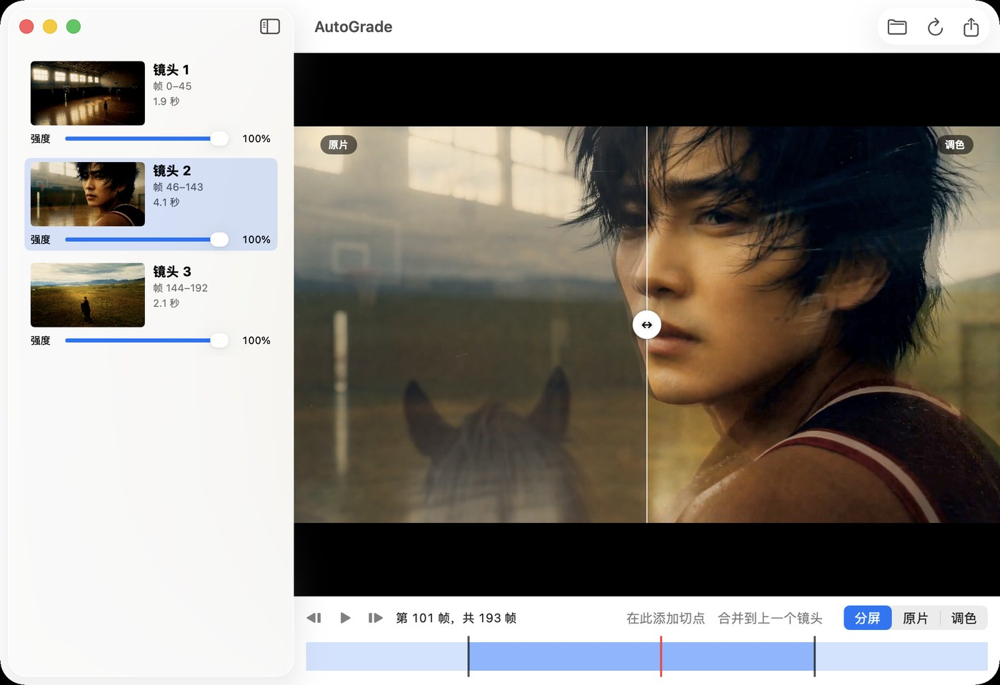

<!-- README_SYNC: source=main@8646248+working-tree; updated=2026-11-02 -->
<p align="center"><a href="./README.md">简体中文</a> · English</p>

# AutoGrade

Automatically grade video by shot on your Mac. AdaInt produces a 3D LUT for each shot; preview the result, adjust strength and cuts, then export video and `.cube` files.

If AutoGrade is useful to you, consider [giving it a star](https://github.com/Shaojie66/AutoGrade/stargazers) so you can find it again and others can discover it too.

[](https://github.com/Shaojie66/AutoGrade/stargazers)
[](#requirements)
[](project.yml)
[](https://github.com/Shaojie66/AutoGrade/issues)
[](https://github.com/Shaojie66/AutoGrade/commits/main)
[](LICENSE)

> [!IMPORTANT]
> The code is source-available under PolyForm Noncommercial 1.0.0; non-commercial use only. The model weights were trained on MIT-Adobe FiveK, and `fixtures/` contains FiveK images; both are for research use only, with no commercial use (see [Licensing and assets](#licensing-and-assets) and [licenses/README.md](licenses/README.md)).



App screenshot from 2026-11-02: the `gym` clip has 3 shots, with frame 101 showing the original and graded image side by side. The UI is shown in Chinese; English is available in Settings.

## Why AutoGrade

- **One LUT per shot**: the model predicts per frame, then averages those predictions within each shot to reduce frame-to-frame flicker. In the `comic` trial, maximum inter-frame flicker fell from 7.8 levels with per-frame grading to 2.9 with per-shot grading.
- **Portable output**: export one 65³ `.cube` per shot by default. Applying it with ffmpeg `lut3d` differed from Metal by at most 1 LSB.
- **Native runtime**: Swift, Metal, CoreML and AVFoundation, with no Python or ffmpeg runtime dependency. A 4K analysis measured about 15–17 ms/frame on a loaded machine; treat this as a reference only.
- **Checked against reference implementations**: AiLUT application matched the upstream official operator at 8-bit 0 LSB; preview and pre-encode export pixels match byte for byte. For one measured frame, preview display differed from QuickTime by ≤0.4 levels.
- **Editable cuts**: adding a cut reanalyses only the affected shot; removing a cut merges accumulated sums exactly, without reanalysis.

## Quick start

### Requirements

You need macOS 15 or later, Apple Silicon, Xcode and `xcodegen`. `Resources/Models/AdaIntFiveK.mlpackage` is already in the repository; a normal build does not need Python. The research workflow also requires `uv`, Python 3.11, `ffmpeg`, `ffprobe` and the original test videos. The full test suite requires `ffmpeg`; without it, the ffmpeg `.cube` comparison test is skipped.

From the repository root, build the app and open the synthetic sample:

```bash
xcodegen generate
xcodebuild -project AutoGrade.xcodeproj -scheme AutoGrade \
  -derivedDataPath build/DerivedData build
open -a build/DerivedData/Build/Products/Debug/AutoGrade.app fixtures/synthetic_shots.mp4
```

Analysis starts on opening. Preview the result, adjust shot strength or cuts, and export when ready.

## Using the app

1. Open a video with `⌘O`, drag it into the window, or use the `open -a` command above. Analysis can be cancelled.
2. The shot list shows thumbnails, frame ranges, durations and a 0–100% strength slider per shot. Select a shot to seek to it. Choose split, original or graded preview; drag the split line to compare.
3. Drag the timeline to seek, play the clip or step through frames. Both halves of a split retain the original strength; a merged shot keeps the previous shot's strength.
4. Export HEVC or ProRes 422 video, optionally with a `.cube` per shot. For an existing video, the save panel asks before replacement and writes a temporary file in the same directory first; existing `.cube` files require separate confirmation.
5. Settings offers system language, English and 简体中文; changes take effect immediately.

| Action | Shortcut |
|---|---|
| Open video | `⌘O` |
| Export | `⌘E` |
| Play / pause | `Space` |
| Previous / next frame | `←` / `→` |
| Add cut at playhead | `⌘K` |
| Merge into previous shot | `⌘⌫` |

## Using the command line

Build the Release executable, then grade the synthetic clip and export a LUT for each shot:

```bash
xcodebuild -project AutoGrade.xcodeproj -scheme autograde \
  -configuration Release -derivedDataPath build/DerivedData build
mkdir -p out
build/DerivedData/Build/Products/Release/autograde fixtures/synthetic_shots.mp4 \
  -o out/synthetic_graded.mov --cube-dir out
```

```text
autograde <input> -o <output.mov> [--cube-dir DIR] [--cut 0.25] [--size 65] [--codec hevc|prores]
```

- `-o` / `--output`: output `.mov` path.
- `--cube-dir`: optionally write one `.cube` per shot, prefixed with the input filename.
- `--cut`: colour-histogram L1 distance threshold for cuts; default `0.25`.
- `--size`: LUT lattice points per axis; default `65`, range `2...129`.
- `--codec`: `hevc` or `prores`, default `hevc`; `-h` / `--help` prints usage.

The CLI refuses to overwrite an existing video or `.cube`; choose new output paths.

## How it works

In the first pass, video is decoded, converted to RGB and resized before AdaInt predicts LUTs and vertices per frame. A colour histogram detects cuts. Predictions are baked onto a uniform lattice, accumulated and averaged per shot, then clamped to `[0, 1]`. In the second pass, the video is decoded again, the final shot LUT is applied and the result encoded as `.mov`; the same LUT can be exported as `.cube`.

Input is treated as display-referred. Model input uses bilinear resizing with `align_corners=False`; strength blends each shot LUT with an identity LUT. Preview and export share the analysis, final strength-adjusted LUTs and Metal grading kernels. The split view selects source pixels and displays them through `AVSampleBufferDisplayLayer`. Start with [Core/AutoGrader.swift](Core/AutoGrader.swift); colour conventions are in [CLAUDE.md](CLAUDE.md).

### Correctness and measurements

`Tests/` compares pipeline stages with `fixtures/`. AiLUT and uniform LUT operations are checked against the official upstream C++ CPU operators; resizing and model output are compared with PyTorch. [fixtures/manifest.json](fixtures/manifest.json) records shapes, types and SHA-256 hashes, which are checked on read.

These are existing measurements from **2026-11-02 on Apple M4 Max**, not results rerun for this README:

- XCTest: 22 AutoGradeCore and 3 AutoGradeAppTests passed, with 0 skipped. Maximum resize error was `1.2e-7`; CoreML vs PyTorch maximum LUT / vertices errors were `3.6e-7` / `1.8e-7`.
- AiLUT application across 4 images and 65³ shot LUT application both matched at 8-bit `0 LSB`; ffmpeg `lut3d` applying the exported `.cube` differed from Metal by at most `1 LSB`.
- `testPreviewIsByteIdenticalToExport` checks preview against pre-encode pixels byte for byte; absolute mean channel deviations after an HEVC export round trip were ≤0.71 levels.
- In a Display P3 screenshot of the centre 20% of `gym` frame 101, preview was `(126.0, 93.9, 52.0)` and QuickTime `(126.4, 93.7, 52.2)`, within ≤0.4 levels per channel. This is a measurement of that specific frame.
- In Release, at machine load 23–25 with `ollama` using over 200% CPU, 4K analysis measured `15–17 ms/frame` and rendering `14–17 ms/frame`; 1080p analysis measured `5–9 ms/frame` and rendering `5 ms/frame`. The first CoreML call includes one-time compilation.

### Build and test

Run `xcodegen generate` again after adding or removing files. The build compiles Metal kernels through `Tools/build-metallib.sh` with safe math and precise fp32 functions. Check both the test and skipped counts:

```bash
xcodegen generate
xcodebuild -project AutoGrade.xcodeproj -scheme AutoGradeCore \
  -derivedDataPath build/DerivedData test
xcodebuild -project AutoGrade.xcodeproj -scheme AutoGradeAppTests \
  -derivedDataPath build/DerivedData test
xcodebuild -project AutoGrade.xcodeproj -scheme autograde \
  -derivedDataPath build/DerivedData build
xcodebuild -project AutoGrade.xcodeproj -scheme AutoGrade \
  -derivedDataPath build/DerivedData build
open build/DerivedData/Build/Products/Debug/AutoGrade.app
```

### Research workflow

Python is confined to `research/` for model conversion and reference fixture generation. These commands fetch the pinned upstream AdaInt version and create a project-local virtual environment. If the upstream directory exists at a different commit, the script exits with an error without deleting it.

```bash
research/fetch_upstream.sh
uv venv --python 3.11 research/.venv
uv pip install --python research/.venv/bin/python -r research/requirements.txt
research/.venv/bin/python -I research/convert_coreml.py
```

Conversion writes `Resources/Models/AdaIntFiveK.mlpackage`. Fixture generation needs upstream assets and `gym_1080p.mp4` and `comic_multishot.mp4` under `~/camera/experiments/adaint/data/`. Generation overwrites the corresponding `fixtures/` files; `--verify` instead generates in a temporary directory and compares byte for byte.

```bash
PATH="$PWD/research/.venv/bin:$PATH" research/.venv/bin/python -I research/make_fixtures.py
PATH="$PWD/research/.venv/bin:$PATH" research/.venv/bin/python -I research/make_fixtures.py --verify
```

## Known limitations

- Input must be 8-bit 4:2:0 BT.709 limited range. 10-bit, HDR, ProRes input and full-range video are rejected, so exported ProRes cannot be used as input either. A missing colour-matrix tag is treated as BT.709 with a warning.
- Neither preview nor export carries audio; video rotation metadata is not handled.
- Cuts and strength adjustments are lost when the app closes. There is no undo / redo or batch processing.
- Thumbnails are resized before grading and displayed as `CGImage`, so their colour is approximate; use the preview for judgement.
- Histogram-based detection handles hard cuts, not dissolves; add those cuts manually. The area around `gym` frame 96 is one example. Use threshold `0.25` for low-saturation footage.
- FiveK weights tend to correct photos towards a normal look rather than a cinematic style, and may brighten intentionally dark footage.
- The CLI does not overwrite existing video or `.cube` files; see the app instructions for its replacement behaviour.

## Licensing and assets

The project's own code, documentation and tools are licensed under [PolyForm Noncommercial 1.0.0](LICENSE): source-available; free for permitted non-commercial use; commercial use requires prior authorization, and you can get in touch through an [issue](https://github.com/Shaojie66/AutoGrade/issues).

The portions ported from AdaInt are Apache-2.0 ([licence text](Resources/Models/AdaInt-LICENSE.txt)), including the model and operator wrappers in `research/oracle/ailut.py` and `ailut_eval`, `lower_bound_clamped` and `lut_apply` in `Core/Shaders/Grade.metal`. The two MIT-Adobe FiveK licences permit only your own research use and exclude commercial purposes; verified 2026-11-02, with the texts and notes in [licenses/README.md](licenses/README.md). The licence text addresses images and does not explicitly settle the status of trained weights; this project treats its weights as **research use only, no commercial use**.

`fixtures/demo_*` derives from FiveK image `a4739`; copies must include the copyright notice and full licence. The `gym` and `comic` test videos were generated with Jimeng; the full videos are not in git, only a few downscaled extracted frames. `fixtures/synthetic_shots.mp4` contains synthetic test patterns.

## Project rules

See [CLAUDE.md](CLAUDE.md) for architecture, precision, operational boundaries and the safety rules for hands-on UI acceptance.

## Get involved

If you want to keep track of the project, [star it](https://github.com/Shaojie66/AutoGrade/stargazers). You can also [watch](https://github.com/Shaojie66/AutoGrade) for updates or report a problem in an [issue](https://github.com/Shaojie66/AutoGrade/issues).
